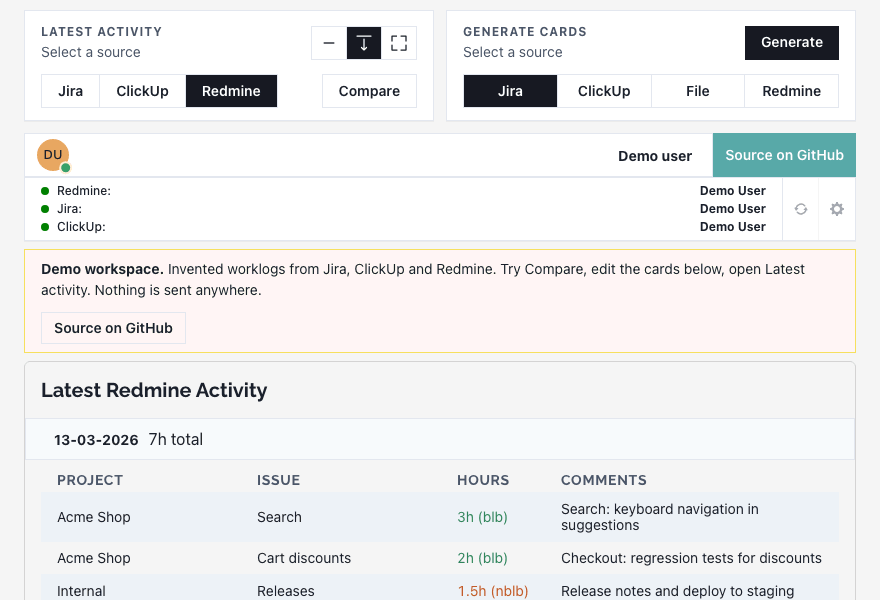
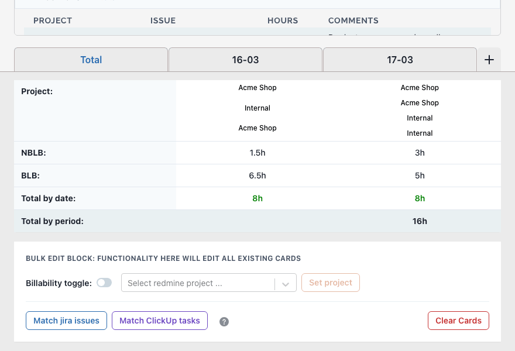
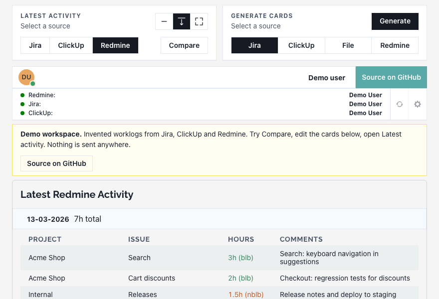

# Worklog Hub

**Log hours once. Move them between trackers.**



[](LICENSE)
[](https://misyuk-t.github.io/worklog-hub/demo/)
[](https://misyuk-t.github.io/worklog-hub/)

Teams that track time in one system for themselves and another for a client end up typing the same hours twice. Worklog Hub reads worklogs from **Redmine**, **Jira** or **ClickUp**, or from a TXT or XLSX file, turns them into cards you can edit, and submits them to another tracker. Compare, a secondary view, puts two sources side by side for a date range, so you can spot missing or mismatched entries.

## Features

- **Read** worklogs from Redmine, Jira (several sites) and ClickUp (several teams), or from a TXT or XLSX file.
- **Cards**: one per entry. Edit hours, project, task and the billable flag, one card or all at once.
- **Submit** the cards to Redmine, Jira or ClickUp. Jira keys and ClickUp task ids in a description are matched for you.
- **Compare** two trackers day by day. Edit or delete an entry straight from the comparison.



### Compare

Pick two trackers and a date range. Each day shows both sides with a total, and marks entries that are missing or have different hours.



## Try it

**[Open the demo](https://misyuk-t.github.io/worklog-hub/demo/)**. It opens on a workspace with invented data. No sign-in, and nothing is sent anywhere. Generate makes cards from the invented data, and Submit only tells you how many worklogs it would save.

## Your keys

Each tracker needs a personal API key. What the code does with it:

- **Storage.** Keys are saved in the Firebase Realtime Database of the app's Firebase project, in plain text, under your user record (`users/<id>/settings`). The rules in [`react-app/database.rules.json`](react-app/database.rules.json) let a signed-in user read and write only their own record.
- **Use.** The browser sends each request to the proxy in [`server/`](server/) with the key in an `X-*` request header, never in a URL. The proxy calls the tracker's API over HTTPS and returns the answer. It does not store keys or log them, and error messages have keys masked.
- **Who can see them.** You, and whoever runs the Firebase project and the proxy. If that is not acceptable, run your own copy (below).
- **Any Redmine host.** You type the address of your own Redmine, Jira sites and ClickUp teams in Settings.
- **The demo** is a separate build (`VITE_DEMO=true`) with generated data. The regular build has no demo mode.

Use keys with the narrowest access your tracker allows, and revoke them when you stop using the app.

## Quick start (run your own)

You need Node.js 18 or newer, a Firebase project with Google sign-in and a Realtime Database, and a place to run the proxy.

1. Create the Firebase project. Enable Google sign-in and a Realtime Database, then deploy the rules: `cd react-app && firebase deploy --only database`.
2. Start the proxy: `cd server && npm install && node server.js` (port 8000, set `PORT` to change it).
3. Configure and start the frontend: `cd react-app && cp .env.example .env.local`, fill in `VITE_BASE_URL` (the proxy) and the `VITE_FIREBASE_*` values, then `yarn install && yarn dev`.
4. Sign in, open **Settings** (gear icon), paste your keys and tracker addresses, press **Save & Use**.

To look around without any setup, run the demo build: `cd react-app && yarn install && VITE_DEMO=true yarn dev`.

## More

<details>
<summary><b>Local development</b>: run, demo build, regenerate the GIFs</summary>

<br>

```sh
cd server && npm install && node server.js      # proxy on :8000
cd react-app && yarn install && yarn dev          # frontend, prints its own URL
cd react-app && VITE_DEMO=true yarn dev           # demo build, no Firebase and no proxy needed
```

Without a Firebase config the sign-in button is disabled. The animated GIFs in `docs/media/` and the social image of the website come from [`tools/readme-media/`](tools/readme-media/), an isolated tool with its own `package.json`:

```sh
cd tools/readme-media && npm install && npx playwright install chromium
npm run media            # builds the demo, records docs/media/*.gif
npm run media -- --og    # also redraws site/assets/og-image.png
```

</details>

<details>
<summary><b>Project layout</b></summary>

<br>

- `react-app/`: Vite, React 18, Chakra UI, Zustand. The demo build lives in `react-app/src/demo/`.
- `server/`: Express proxy for the three tracker APIs. It parses TXT and XLSX imports and throttles calls with `bottleneck`.
- `site/`: the landing page (plain HTML and CSS, self-hosted fonts, no scripts from other hosts).
- `tools/readme-media/`: records the GIFs and draws the social image.
- `.github/workflows/pages.yml`: publishes `site/` at the root of GitHub Pages and the demo build under `/demo/`.

</details>

<details>
<summary><b>Checks</b></summary>

<br>

```sh
cd react-app && yarn test && yarn lint && yarn build
cd server && npm test
```

</details>

<details>
<summary><b>Deploying the proxy</b>: any Node host works</summary>

<br>

The proxy is a plain Node 18 Express app: `npm install && npm start`, listening on `PORT` (default 8000). Put it behind HTTPS, because the keys travel in request headers, and point `VITE_BASE_URL` of the frontend build at its public address. CORS is open to any origin, so the keys are what protects it. Do not log request headers on the host in front of it. The proxy keeps nothing on disk.

</details>

<details>
<summary><b>Known limits</b></summary>

<br>

- The Redmine billable flag assumes a custom field with id 7 (values 1 and 3). Other Redmine setups need that mapping changed in `react-app/src/helpers/transformToRedmineData.js`.
- The interface is built for desktop. On phones the panels stack and the wide tables scroll sideways.

</details>

## License

[MIT](LICENSE).
